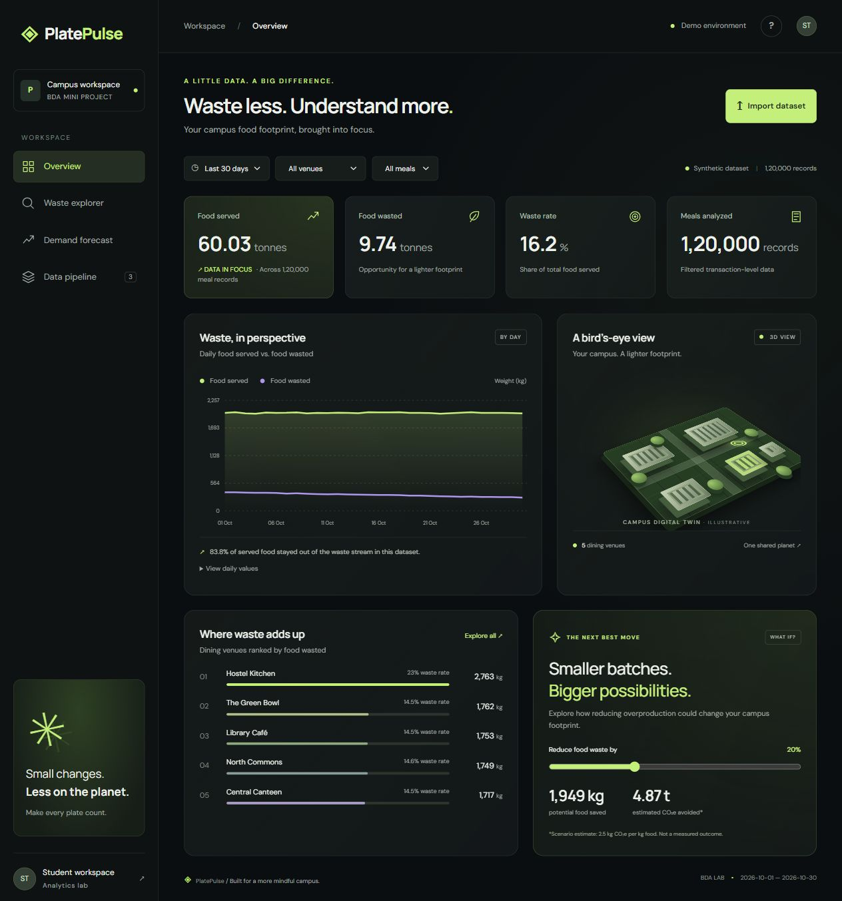

# PlatePulse — Campus Food Waste Intelligence

A Big Data Analytics mini project that turns dining transaction data into waste hotspots, demand forecasts, and reduction scenarios. The interface uses frosted glass panels, restrained lime accents, a CSS 3D campus model and pointer tilt, with responsive layouts and reduced-motion support.

**Stack:** Node.js · JavaScript · HTML/CSS · SVG charts · CSV · Node test runner



## Quick start

Requires Node.js 20 or newer. No package installation, API key, or database required.

```sh
git clone https://github.com/asadullah098/PlatePulse-Campus-Food-Waste-Intelligence.git
cd PlatePulse-Campus-Food-Waste-Intelligence
npm start
```

Open **http://localhost:3000** and keep the terminal running. Stop with **Ctrl+C**. No `npm install`, build step, `.env`, API key or database setup is needed. The app uses Node's built-in modules. Google Fonts are optional and fall back to local sans-serif fonts.

For Windows troubleshooting, alternate ports and detailed steps, see the [setup and run guide](docs/RUNNING.md).

## Datasets for testing and presentation

All included datasets are synthetic. The default server creates 120,000 records in memory; the separate presentation file provides a deliberately structured scenario with clear anomalies and venue differences.

| Dataset | Records | Purpose |
| --- | ---: | --- |
| [presentation-data.csv](datasets/presentation-data.csv) | 36,000 | Main presentation: 30 dates, 5 venues, 3 meal types, waste hotspots and simulated incidents |
| [quick-check.csv](datasets/quick-check.csv) | 4 | Manually verify 100 kg served, 20 kg wasted and 20% waste |
| [valid-boundaries.csv](datasets/valid-boundaries.csv) | 3 | Accepted zero-waste, full-waste and tiny-portion boundary cases |
| [invalid-waste.csv](datasets/invalid-waste.csv) | 1 invalid | Demonstrate rejection of waste greater than served weight |
| [sample.csv](sample.csv) | 14 | Small venue/day example; rows represent meal-service batches rather than individual transactions |

Select **Import dataset**, choose the main presentation CSV, and set **Last 30 days → All venues → All meals**. Expect **36,000 records**, **17.72 tonnes served**, **3.09 tonnes wasted**, and a **17.4% waste rate**. Next-day forecast: **603.4 kg**. Waste explorer flags **October 18**; filtering to **Hostel Kitchen → Dinner** also flags **October 26**.

See the [presentation and dataset guide](datasets/PRESENTATION-GUIDE.md) for the demo flow, data dictionary context and expected values. Unrounded metrics are in [expected-results.json](datasets/expected-results.json). Regenerate and validate fixtures with `npm run test:datasets`.

**Row meaning matters:** presentation/default datasets use individual meal transactions. The small legacy sample uses meal-service batches, so its record count must not be interpreted as the number of people served. All weights are in kilograms. Included dates extend through October 30, 2026 and represent a hypothetical month, not observed events.

## Test setup

No test libraries or additional setup are needed. From the project root:

```sh
npm run check
npm test
npm run test:datasets
```

The four analytics tests cover deterministic generation, mass conservation, filters, forecasting, CSV validation and anomalies. Dataset verification also checks expected presentation outcomes. GitHub Actions runs syntax, analytics and fixture-reproducibility checks on Node.js 20 and 22. See the [testing guide](docs/TESTING.md) for a full manual acceptance checklist and verification limits.

## What works

- Reproducible 120,000-record dataset (October 2026; synthetic, not real campus measurements).
- Last 7 / 14 / 30 observed dates, venue and meal filters, recomputed on the backend.
- Daily served/wasted trend, venue ranking, waste-rate comparison and full CSV export.
- Validated CSV import (15 MB maximum); data lives in server memory until reset/restart. No uploads leave the local server.
- Daily waste-rate anomaly detection using z-score > 1.5.
- Next-day served-weight forecast using a weighted moving average over up to seven observed days. Weight 1 applies to the oldest, weight N to the newest.
- Interactive what-if waste reduction scenario (5–50%). Illustrative emissions factor: 2.5 kg CO₂e/kg food; assumption only, not a verified lifecycle factor.
- Data pipeline tab explains the algorithms and reports actual aggregation execution time.

The campus model is illustrative, not a geographic map. Generated data covers 30 dates in October 2026, independent of today's date. No metric represents live sensor telemetry. There is no authentication or durable storage; the server binds only to localhost for the classroom demo.

## CSV format

```csv
date,venue,meal,served_kg,waste_kg
2026-10-01,Central Canteen,Lunch,0.50,0.08
2026-10-01,Hostel Kitchen,Dinner,0.65,0.12
2026-10-02,Central Canteen,Lunch,0.45,0.03
```

Date must be a valid ISO date. Meal must be Breakfast, Lunch or Dinner. Served weight must be positive; waste must be nonnegative and no greater than served weight. Simple comma-separated fields only: embedded commas/quoted fields are not supported. Headers may be reordered. Import validation is atomic: an invalid file leaves existing data intact.

## Why it fits BDA

**Problem:** Campus kitchens often see aggregate consumption without understanding where and when waste accumulates. PlatePulse groups transaction records into actionable comparisons and planning signals.

**Volume:** 120,000 records in the reproducible demo, with single-pass aggregations.

**Variety:** Temporal, categorical and numerical dimensions (date, venue, meal, served and waste weights).

**Velocity:** Batch ingestion demonstrated through imports; streaming is a proposed extension, not implemented.

**Veracity:** Schema, date, categorical and mass-balance validation.

**Value:** Identify high-waste venues, inspect unusual days and explore demand and waste reduction.

This is a single-process educational prototype, not a distributed big-data engine. The daily/venue aggregation loop demonstrates map/reduce principles. The dataset is modest enough to run on a student laptop. For genuinely distributed execution, replace ingestion with Kafka topics, store raw events in partitioned Parquet on object storage/HDFS, and run Spark Structured Streaming windowed aggregations. Persist results in PostgreSQL/ClickHouse and keep the dashboard API contract. Benchmark partition counts, throughput and event-time lateness separately.

## Architecture

Browser → local HTTP API → validated in-memory records → filter/map/reduce → analytics JSON → SVG charts and tables.

| File | Purpose |
| --- | --- |
| `server.js` | HTTP API, CSV import/export and local static hosting |
| `analytics.js` | Reproducible data generator, aggregations, anomaly detection, forecast and CSV validation |
| `public/index.html` | Four dashboard views and accessible controls |
| `public/styles.css` | Design tokens, glass panels, CSS 3D scene, tilt and responsive layout |
| `public/app.js` | API integration, charts, filters, import and scenario controls |
| `analytics.test.js` | Data conservation, numerical correctness and validation checks |
| `datasets/` | Presentation/test CSVs, deterministic generator, expected results and viva guide |
| `docs/` | Setup, troubleshooting and testing guides |
| `.github/workflows/test.yml` | Automated checks on Node.js 20 and 22 |

## API

- `GET /api/analytics?days=30&venue=All%20venues&meal=All%20meals`
- `POST /api/import` with raw CSV body
- `POST /api/reset` restores synthetic data
- `GET /api/export` downloads all source records (not only filtered data)

## Suggested viva demo

1. Explain the campus food waste problem and the five Vs above.
2. Show the source-record count, waste rate and venue ranking.
3. Filter to Hostel Kitchen and compare Lunch vs Dinner.
4. Move the reduction slider; explain that savings are a scenario, not an observed impact.
5. Open Demand forecast and explain recency weighting and its limitations.
6. Import `datasets/presentation-data.csv`, demonstrate its October 18 anomaly, then filter to Hostel Kitchen + Dinner to find the October 26 incident.
7. Discuss scaling the aggregation to Spark; distinguish implemented features from proposed architecture.

## Limitations and next steps

The forecast is a baseline with no holdout evaluation or confidence bounds. Waste anomalies use an educational threshold and may reflect attendance rather than a true operational problem. Imports replace rather than append data. Both analytics and export run in a single Node process; large-scale deployment would need streaming backpressure, worker processing, authentication, durable storage and a full CSV parser. No claim is made that reducing waste causes the suggested emissions savings.

## Project description

**Suggested GitHub About:** Campus food waste analytics dashboard with 3D glassmorphism UI, CSV datasets, anomaly detection and demand forecasting. Built as a Big Data Analytics mini project.

**Suggested topics:** `big-data-analytics`, `food-waste`, `sustainability`, `nodejs`, `dashboard`, `data-visualization`, `student-project`, `anomaly-detection`.
